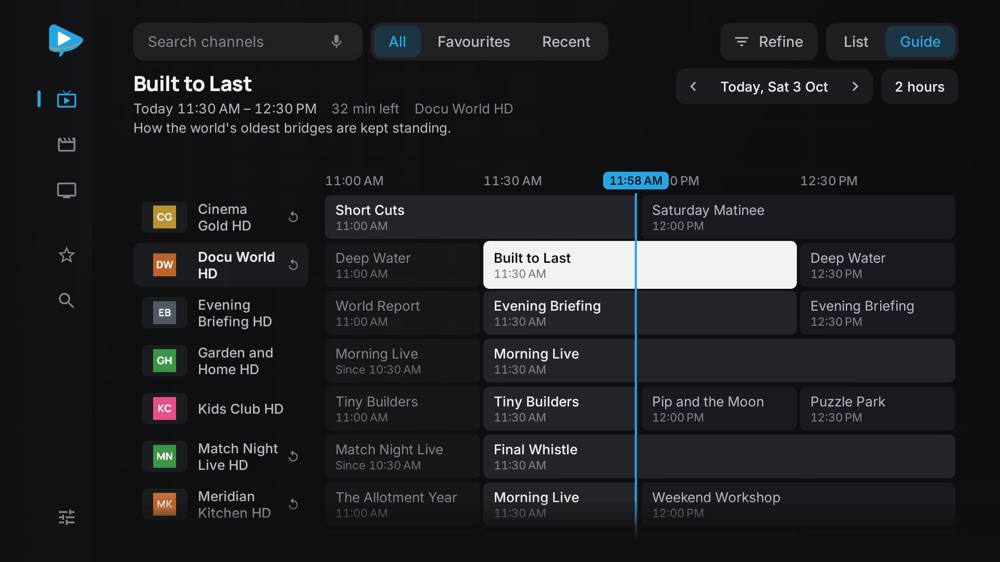
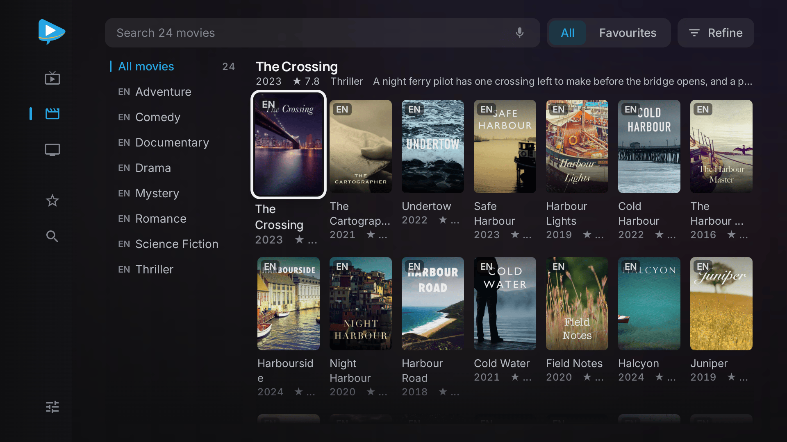
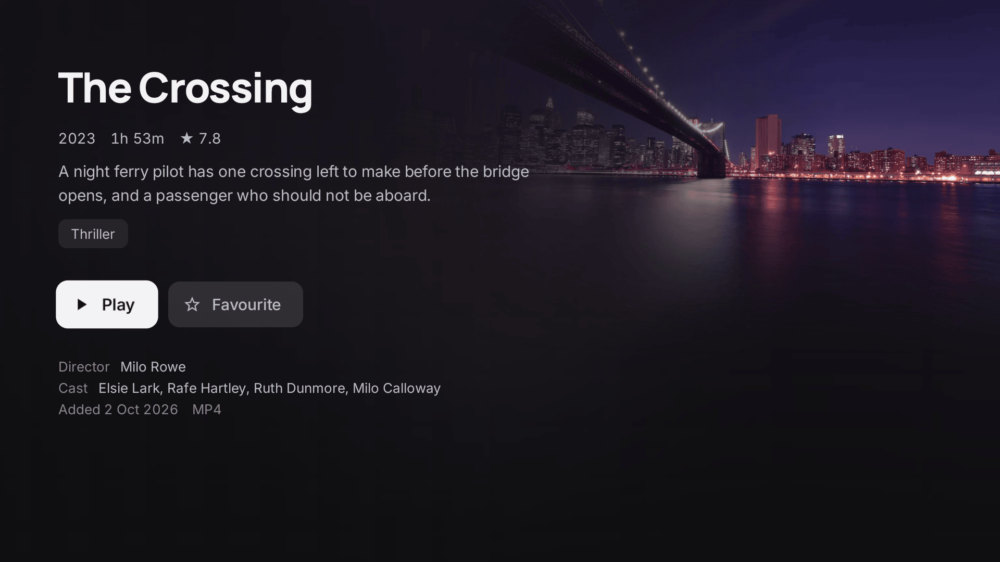
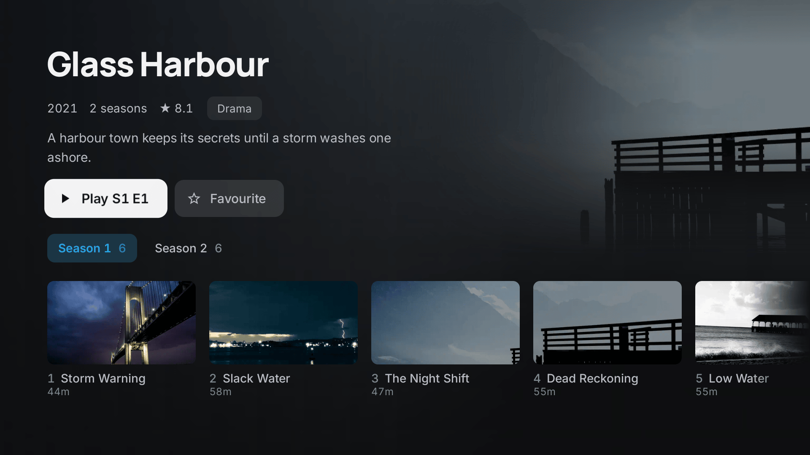
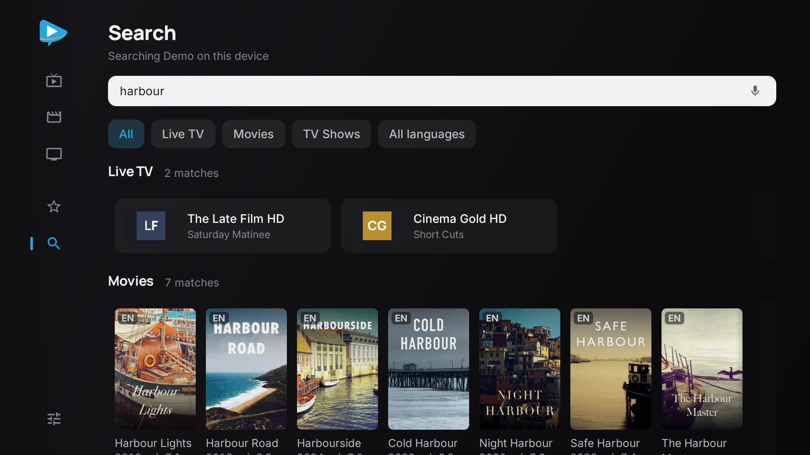
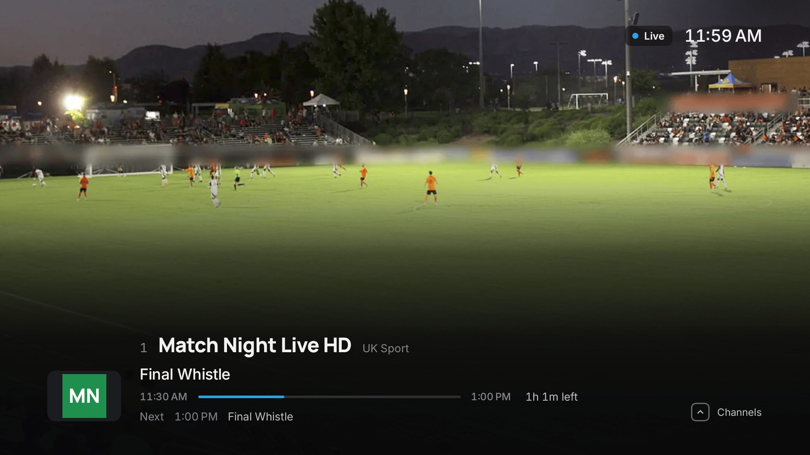

<p align="center">
  <picture>
    <source media="(prefers-color-scheme: dark)" srcset="docs/logo-dark.png">
    
  </picture>
</p>

<p align="center">
  A free, open source IPTV player for Android TV and Google TV.
</p>

<p align="center">
  <a href="LICENSE"></a>
  
  <a href="https://buymeacoffee.com/futsy"></a>
</p>

<p align="center">
  <a href="https://keeltv.com"><b>Website</b></a>
  &nbsp;·&nbsp;
  <a href="https://keeltv.com/#get"><b>Install</b></a>
  &nbsp;·&nbsp;
  <a href="#support-keel-tv"><b>Support the project</b></a>
</p>

<p align="center">
  
</p>

Keel TV comes with no channels and no accounts. You bring an Xtream Codes login or an M3U playlist,
and it plays what your provider sends: Live TV with a real guide, Movies and TV Shows in your
provider's own categories, favourites, Continue Watching and search.

It is a native app built with Kotlin, Compose for TV, Media3 and Room, and you drive it entirely
with a remote. It talks to Xtream and M3U providers, reads XMLTV guides, and keeps its own local
snapshot of the catalogue on the box.

## Where it differs from other IPTV players

- **A language filter.** Most of a provider's catalogue is in languages you do not speak. Choose
  one of more than 50 languages, and Live TV, Movies, TV Shows and search show only what is in it.
  Keel TV reads each title's language from the language and country tags providers already put in
  their names. A country tag counts as that country's languages, so a UK section is English.
  Anything untagged sits under Unknown language.
- **A guide that fills its own gaps.** Providers rarely send listings for every channel. Keel TV
  reads your provider's guide first, then looks up the channels it leaves out in the public XMLTV
  guides at epgshare01.online and merges them into the same grid. It picks the countries from the
  tags on your channel names, so there is nothing to set up, and it never overwrites a channel
  that already has listings.
- **Fast on slow hardware.** Most TV sticks have a slow processor and little memory, and the app
  is built for them. The catalogue is an indexed database on the box, read a page at a time.
  Posters are downloaded at the size they are drawn, and the guide is read only for the rows on
  screen. A refresh runs in the background, so you can keep browsing while it writes.

## What it does

- **Live TV** with the guide beside it: a channel list with categories, favourites and recents, a
  name filter over the categories, a grid guide with day and zoom controls, now and next on every
  row, and the HD, FHD and 4K feeds of one channel folded onto a single row.
- **Catch-up** on any Xtream channel that keeps an archive. Open a finished programme in the guide
  and it plays back as a seekable recording with its own title.
- **The player** a remote expects: a banner, a quick channel list, channel up and down, number
  entry, a seek bar on films and episodes, resume, and track and caption menus.
- **Movies and TV Shows** as one browse screen over the whole catalogue. It sorts by provider
  order, A to Z, recently added, top rated or newest first, and narrows by language, genre, year
  and rating. Category names are tidied for reading, without the provider's prefixes and tags, and
  every poster the provider calls 4K carries a 4K mark.
- **Search** across channels, films and series, by remote keyboard or by voice.
- **Library** with favourites and Continue Watching. The app also writes Continue Watching to the
  Google TV home screen's own Continue Watching row.
- **Settings** for sources, playback, captions, the guide and the catalogue, including adding,
  switching and removing providers.

## Screenshots

<table>
  <tr>
    <td width="50%"><br><sub><b>Movies.</b> The whole catalogue on one screen, sorted and filtered your way.</sub></td>
    <td width="50%"><br><sub><b>Film details.</b> Plot, cast and rating, one click from playing.</sub></td>
  </tr>
  <tr>
    <td width="50%"><br><sub><b>TV Shows.</b> Seasons and episodes at a glance.</sub></td>
    <td width="50%"><br><sub><b>Search.</b> Channels, films and series, by keyboard or by voice.</sub></td>
  </tr>
  <tr>
    <td colspan="2"><br><sub><b>The player.</b> Built for a remote, with now and next always a press away.</sub></td>
  </tr>
</table>

<sub>Screenshots use made-up channels and films. Keel TV comes with no content of its own.</sub>

## Support Keel TV

Keel TV is free and open source. If it has earned a place on your TV, you can buy me a coffee. It helps me keep shipping updates, fixing what breaks and building
what comes next.

<p>
  <a href="https://buymeacoffee.com/futsy"></a>
</p>

Not in a position to give? Starring the repository and telling a friend helps too.

## Install it

Keel TV is not on the Google Play Store. Install it on a TV with the Downloader app, following the
steps at [keeltv.com](https://keeltv.com/#get), or download `keeltv.apk` from the
[latest release](../../releases/latest). After that the app offers each new build itself, under
Settings, About.

## Build and sideload it

Run these from the repository root:

```bash
./gradlew assembleDebug
adb connect <your-tv>:5555
adb install -r app/build/outputs/apk/debug/app-debug.apk
```

Run `./gradlew assembleDebug` before you open a pull request. CI runs the same command.

`./gradlew assembleRelease` builds a minified APK. Without a keystore of your own it is signed with
the debug key, so you can still sideload it.

## How it works, and what it leaves out

- **Playback is Media3**, so MKV, HEVC and MPEG-2 play natively.
- **Audio the box cannot decode is decoded in software.** A TV stick usually has no MP2, AC-3 or
  DTS decoder, so `libs/media3-decoder-ffmpeg-1.11.1.aar` carries one. It sits behind the
  platform decoders, so hardware decoding and AC-3 passthrough still win where they exist. The AAR
  is checked in rather than compiled per build, so no NDK is needed.
  `scripts/build-ffmpeg-decoder.sh` rebuilds it from pinned sources, and `libs/README.md` has the
  licence notice.
- **No casting.** The box is the cast target.
- **No external subtitles and no caption delay.** The player shows the subtitle tracks in the
  stream, styled by the caption settings. It cannot side-load an SRT file or shift the timing.
- **Catch-up is Xtream only.** An M3U entry carries one playable URL and nothing that can rebuild
  it for a past hour, so a playlist channel never offers catch-up.
- **TrueHD is not decoded.** Media3's Matroska extractor batches its access units in a shape the
  bundled FFmpeg decoder rejects. A TrueHD track reports unsupported and the player says so,
  rather than looping on a decode error. Everything else the box cannot handle, including MP2,
  AC-3, E-AC-3, DTS and ALAC, is decoded in software.
- **Deep links and voice.** `keeltv://play` and `keeltv://search` links, the remote's microphone
  and the assistant's "search X in Keel TV" all open the right screen.
- **The guide holds three hours back to two days ahead**, and automatic country feeds are capped
  at four, because a full XMLTV set is larger than a TV box wants on disk.
- **The catalogue is Room plus Paging**, so even a very large lineup loads a page at a time.

## Repository layout

```
app/         the app's source and resources
libs/        the prebuilt FFmpeg audio decoder and its licence notice
scripts/     build-ffmpeg-decoder.sh, which rebuilds that decoder
gradle/      the Gradle wrapper and the version catalogue
docs/        the logo and screenshots this README shows, and the typefaces' licences
.github/     CI workflows
```

The Gradle build files and wrapper scripts sit at the root beside them.

## Licence

Keel TV is free software under the GNU General Public License, version 3 or later. See
[LICENSE](LICENSE).

The licence covers the code, not the Keel TV name or logo. If you ship a modified version, give it
its own name and mark.

## Third-party notices

The app bundles FFmpeg, unmodified and built without `--enable-gpl` or `--enable-nonfree`, under
the LGPL v2.1 or later. See [libs/README.md](libs/README.md) for the pinned sources and the rebuild
script.

The app's typefaces are Inter and Manrope, each under the SIL Open Font License 1.1. See
[docs/Inter-OFL.txt](docs/Inter-OFL.txt) and [docs/Manrope-OFL.txt](docs/Manrope-OFL.txt).

Posters and backdrops that a provider links from TMDB are loaded from TMDB's image servers. Keel TV
is not endorsed, certified or otherwise approved by TMDB.
